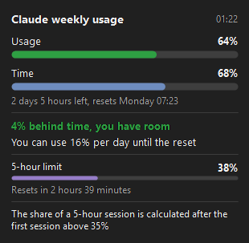
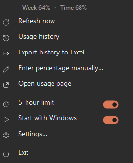
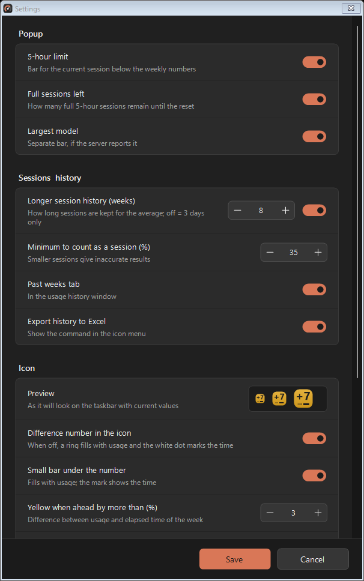

<p align="center">
  
</p>

<h1 align="center">Claude Usage Tray</h1>

<p align="center">
  <b>Track your Claude usage from the Windows tray, and find out exactly how much of your weekly limit one 5-hour session costs.</b>
</p>

<p align="center">
  
  
  
  
</p>

<p align="center">
  &nbsp;&nbsp;
  
</p>

## Why

Claude subscriptions have two limits: a **5-hour limit** and a **weekly limit**. The usage page shows both as percentages, but not how they relate.
This app has two goals:

1. **Track your usage at a glance:** a tray icon that turns yellow or red when you use the weekly limit faster than the week passes.
2. **Know precisely what a 5-hour session costs:** it records every session and measures how many percent of the *weekly* limit a full 5-hour session uses (for example "a full 5-hour session ≈ 9 % of the week"). From that it tells you how many full sessions you have left until the weekly reset.

## Features

- Icon color: green = on track, yellow / red = using faster than time passes, blue = plenty of room left
- Popup: weekly usage, elapsed time, time until reset, daily budget, 5-hour limit (if your plan has one)
- 5-hour session statistics: how much of the week a full 5-hour session costs, and how many full sessions you have left
- Usage history with charts (today, yesterday, day before, past weeks), CSV export
- Works with Pro, Max and other plans: the numbers come straight from Claude's servers. Plans with a weekly limit only (no 5-hour limit) hide the 5-hour parts.
- Languages: English, 中文, Español, Français, Deutsch, العربية (Settings → Language, default = Windows language)
- Updates itself from the GitHub releases (Settings → Automatic updates), or on demand with **Check for updates** in the menu
- No model calls, so it does not use any of your quota. About 45 MB RAM.

<details>
<summary>Settings window</summary>
<p align="center"></p>
</details>

## Requirements

- Windows 10 or 11 (uses the .NET Framework 4.x that ships with Windows)
- **Claude Code** installed and signed in with your Claude subscription (`claude` → `/login`)

## Where the data comes from

The app reads the sign-in that **Claude Code** saves on your PC, in `%USERPROFILE%\.claude\.credentials.json`.
With it, it asks Claude's server for your current usage (`api.anthropic.com/api/oauth/usage`), the same numbers you see on [claude.ai/settings/usage](https://claude.ai/settings/usage).

- Once a day it also asks GitHub (`api.github.com`) whether a newer release exists. A new version is only installed when its SHA-256 matches the checksum GitHub shows for the release file.
- Nothing is sent anywhere else. Settings, cache and history stay in `%APPDATA%\ClaudeUsageTray\`.
- When the saved sign-in expires, the app renews it the same way Claude Code does and writes it back to the same file (a one-time backup is kept as `.credentials.json.bak-usage-tray`).
- No Claude Code sign-in? Use **Enter percentage manually** in the menu and type the number from the usage page.

> The usage endpoint is not an official, documented API. It can change at any time and the app may then stop showing data until it is updated.

## Install

1. Download `ClaudeUsageTray.exe` from [Releases](../../releases).
2. Run it. The icon appears in the tray (you may need to drag it out of the hidden icons area).
3. It starts with Windows by default (can be switched off in the menu or settings).
4. New versions install themselves (can be switched off in settings). See [CHANGELOG.md](CHANGELOG.md) for what changed.

## Build from source

No SDK needed, the C# compiler that ships with Windows is enough:

```powershell
.\build.ps1
```

The result is `bin\ClaudeUsageTray.exe`.

Check options: `--png <file> [lang] [demo]` renders the popup, menu and icons to pictures, `--settings <file> [lang]` the settings window, `--test <base>` runs the session statistics self-test, `--update-now` checks for and installs a newer release without the tray (exit code 0 = updated, 1 = up to date).

To release: raise `Updater.Version` in `src/Updater.cs`, add an entry to `CHANGELOG.md`, build, and publish a GitHub release tagged `v<version>` with `bin\ClaudeUsageTray.exe` attached under that exact name.

## Adding a language

All text is in [`src/Lang.cs`](src/Lang.cs). Add a code and name to `Codes`, `Names` and `Cultures`, then one more string at the end of every entry.

## Disclaimer

This is an independent project, not made by or affiliated with Anthropic. "Claude" is a trademark of Anthropic.

## License

[MIT](LICENSE)
